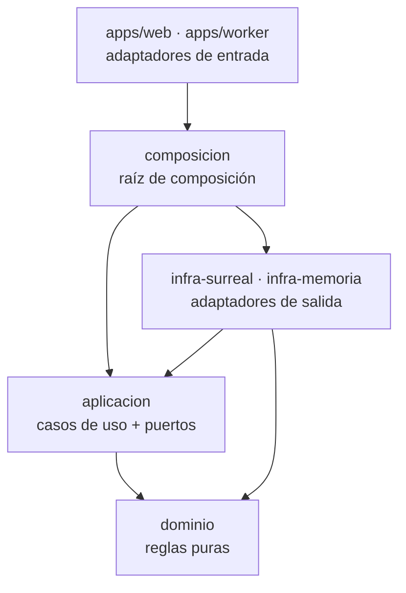

# Arquitectura de finanzas-rs

Guía de trabajo para cualquier persona o sesión que continúe el proyecto. Si algo de
este documento deja de ser cierto, se corrige aquí en el mismo commit que lo cambia.

Documentos relacionados:

- [`reglas.md`](reglas.md): catálogo de reglas de negocio con su código y estado.
- [`diseno.md`](diseno.md): sistema visual de la interfaz.
- [`../AGENTS.md`](../AGENTS.md): preferencias del usuario y reglas de trabajo.

---

## 1. Contexto

finanzas-rs reemplaza una hoja de cálculo con una mini app (Google Apps Script) que
lleva las finanzas personales por quincena: presupuesto, extras con su fecha real de
pago, caja chica, fondo de emergencia, gastos puntuales y deudas.

La hoja funciona, pero tiene las reglas repartidas en fórmulas, depende de una sola
persona y no se puede compartir. finanzas-rs pone esas reglas en código probado y
deja el sistema listo para varios usuarios.

Restricciones:

- **Costo cero o casi cero** en la nube (planes gratuitos de Cloudflare y SurrealDB).
- **Una sola app, dos niveles.** En el celular (PWA instalable, sin tienda) va lo del
  día: anotar, ver caja chica y quincena, marcar pagos. En la computadora va todo:
  proyecciones, deudas, fondo, calendario de cortes, historial y configuración. Es la
  app completa, no un formulario como la de Apps Script.
- **Una sola persona lo mantiene:** poco código, claro, sin frameworks genéricos.

---

## 2. Principios

1. **Arquitectura hexagonal (puertos y adaptadores).** Las dependencias apuntan siempre
   hacia adentro.
2. **Toda regla de negocio vive en el dominio, sin excepción.** Los casos de uso
   orquestan, no deciden.
3. **El dominio es puro:** sin base de datos, red, reloj del sistema ni aleatoriedad.
4. **El dinero son colones enteros.** Nunca `f64`. Las proporciones van en
   diezmilésimas y el redondeo se define una sola vez (`Proporcion::aplicar`).
5. **Multiusuario desde el diseño.** Cada dato tiene dueño (`UsuarioId`) y los números
   personales son configuración (`Perfil`), no constantes.
6. **Sin ORM.** Las consultas se escriben a la vista, en SurrealQL.
7. **Sin magia:** nada de inyección de dependencias por framework. Las dependencias se
   pasan por constructor.
8. **Simple antes que genérico.** No se construye nada "por si acaso".

---

## 3. Capas y regla de dependencias

| Crate | Qué tiene | Puede depender de |
|---|---|---|
| `dominio` | Entidades, objetos de valor y reglas | `chrono` (sin reloj), `thiserror`, `uuid` (sin generadores) |
| `aplicacion` | Casos de uso y puertos (traits) | `dominio` |
| `infra-memoria` | Puertos en memoria para pruebas y desarrollo | `aplicacion`, `dominio` |
| `infra-surreal` | Puertos sobre SurrealDB (RPC en CBOR por HTTP) | `aplicacion`, `dominio`, `ciborium`, `base64` |
| `contrato` | Pruebas de contrato que cumple todo adaptador | `aplicacion`, `dominio` (sólo como dependencia de pruebas) |
| `composicion` *(siguiente)* | Arma los casos de uso con sus adaptadores | todos los de arriba |
| `apps/worker` *(siguiente)* | API en un Worker de Cloudflare (Rust → WASM) | `composicion` |
| `apps/web` *(siguiente)* | PWA en Angular; usa el dominio compilado a WASM para validar sin red | `dominio` vía WASM |

La pureza del dominio la vigila `crates/dominio/tests/arquitectura.rs`: falla si el
manifiesto gana una dependencia no permitida o si el código usa reloj, aleatoriedad,
red, archivos o variables de entorno.

---

## 4. Patrones

### Objetos de valor que se validan al nacer

`Colones`, `Proporcion`, `Concepto`, `Corte`, `CajaChica`, `PerfilSalarial`… sólo se
pueden crear válidos (constructor que devuelve `Result`). Una vez creado, nadie tiene
que volver a validarlo.

### Un caso de uso por struct

Cada caso de uso recibe referencias a sus puertos por constructor y tiene un solo
método `ejecutar`. Ejemplo: `RegistrarGasto` normaliza el concepto con el dominio,
crea el `Gasto` (que valida el monto), lo guarda y devuelve la caja chica actualizada
usando `ConsultarCajaChica`.

### Puertos asíncronos sin `Send`

Los puertos son `async fn` en traits, sin exigir `Send`, porque en un Worker de
Cloudflare (WebAssembly) los futuros no son `Send`. Por eso `aplicacion` declara
`#![expect(clippy::future_not_send)]` con su razón.

### SurrealDB por RPC binario, con el transporte afuera

`infra-surreal` habla con SurrealDB por su RPC (`POST /rpc`) en CBOR. No se usa JSON
porque SurrealDB convierte por su cuenta todo texto que parezca fecha o UUID: un concepto
como `2026-11-12` dejaría de ser texto. Se probó contra SurrealDB 4.0.1.

El crate no trae cliente HTTP: pide un `EnvioHttp`. En producción será el `fetch` del
Worker; en las pruebas, un cliente nativo. Así compila igual para WebAssembly (lo vigila
la CI) y no elige runtime. Las consultas están escritas a mano junto a cada repositorio.

El esquema (`crates/infra-surreal/src/esquema.surql`) se puede aplicar las veces que
haga falta (`OVERWRITE`). Fechas como texto `AAAA-MM-DD`, dinero en enteros, enumerados
con códigos en MAYÚSCULA validados con `ASSERT`, y el id del registro igual al UUID del
dominio (en `perfil`, el del usuario).

### Pruebas de contrato

`crates/contrato` define qué tiene que cumplir cada puerto: filtrar por usuario, fechas
incluidas, orden por fecha y luego por id, guardar y devolver todo campo intacto, que
guardar un perfil otra vez lo reemplace. `infra-memoria` e `infra-surreal` corren las
mismas funciones, así que un adaptador no puede comportarse distinto sin que se note.

### Errores con tipo

Cada módulo del dominio tiene su enum de error (`thiserror`). `ErrorAplicacion` los
envuelve con `#[from]`, más `PerfilNoEncontrado`, `FueraDeCalendario` y
`Repositorio`. Nada de `unwrap` fuera de las pruebas (lo prohíben los lints).

---

## 5. Multiusuario

- Todo agregado guardado lleva `UsuarioId`.
- El `Perfil` de cada usuario junta su salario, factor neto, rebajos, tarifas de
  extras, tope de caja chica y calendario de cortes del patrono.
- En SurrealDB las tablas tienen `PERMISSIONS NONE`: ningún usuario final entra
  directo a la base. Sólo entra el Worker, con un usuario de sistema, después de
  autenticar a la persona, y toda consulta filtra por `usuario = $usuario`.
- El aislamiento lo comprueban las pruebas de contrato en los dos adaptadores (un
  usuario nunca ve lo de otro), además de `cada_usuario_ve_solo_su_caja_chica`.

---

## 6. Pruebas

- **Dominio:** pruebas unitarias en cada módulo con los números reales de noviembre de
  2026 (las mismas cifras de la hoja: salario neto 232 225, extras del 30 de noviembre
  91 168, sobra de la primera quincena 40 929, caja chica 1 050…).
- **Casos de uso:** `crates/infra-memoria/tests/casos_de_uso.rs`, de punta a punta con
  los adaptadores en memoria.
- **Contrato de los puertos:** `crates/contrato`, corrido por `infra-memoria` en cada
  `cargo test` y por `infra-surreal` contra un SurrealDB real. Esas pruebas están
  marcadas `ignore` porque necesitan el servidor; la CI lo levanta y las corre con
  `--ignored`. Localmente:
  `surreal start --user root --pass root memory` y luego
  `cargo test -p finanzas-infra-surreal -- --ignored`.
- **WebAssembly:** la CI compila `dominio`, `aplicacion` e `infra-surreal` para
  `wasm32-unknown-unknown`.
- **Arquitectura:** `crates/dominio/tests/arquitectura.rs`.

---

## 7. Siguiente

En este orden:

1. ~~`infra-surreal`~~: hecho (esquema, repositorios de perfil, gastos y extras,
   contrato compartido con `infra-memoria`).
2. Casos de uso que faltan: quincena (marcar pagos), fondo (retiros y reposición),
   cierre de mes, deshacer.
3. `apps/worker`: API en Rust sobre Cloudflare Workers.
4. `apps/web`: PWA en Angular, siguiendo el sistema visual de [`diseno.md`](diseno.md).
5. Migración de los datos de la hoja.
